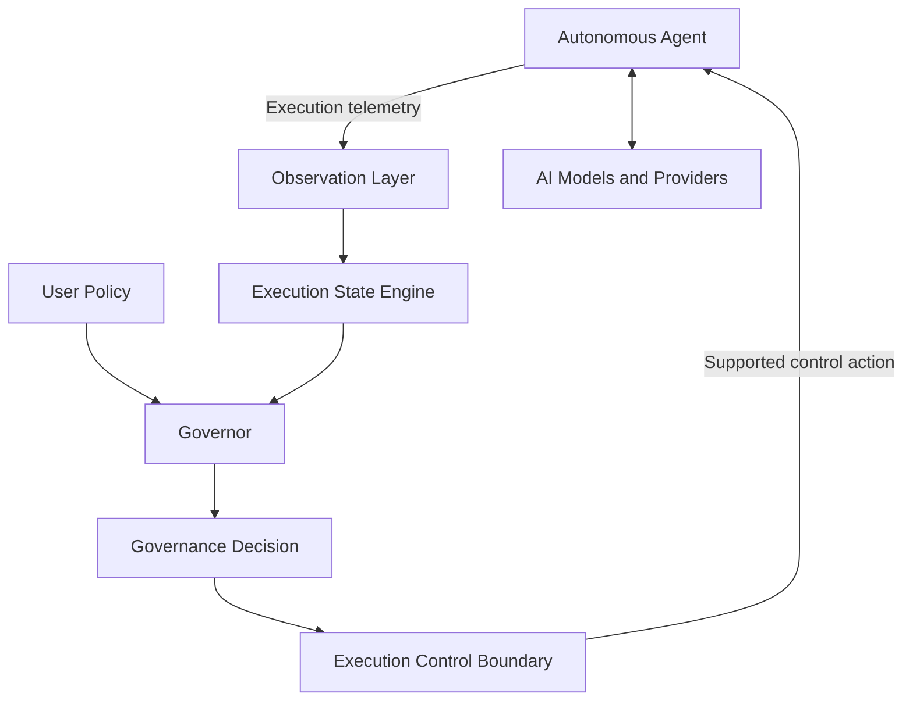
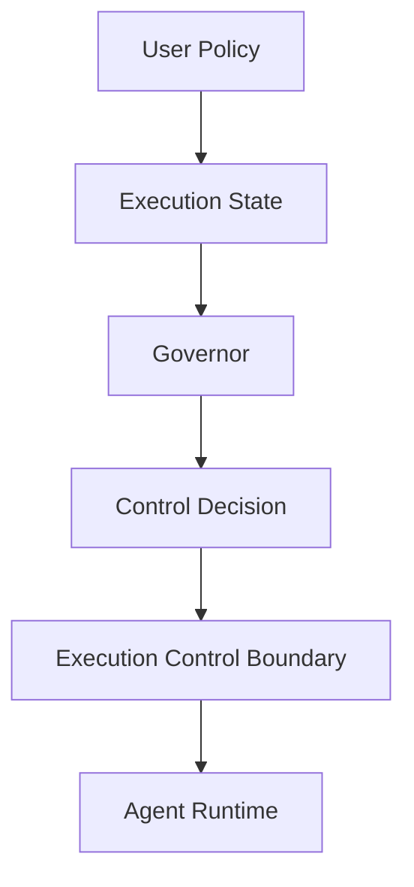

 <p align="center">
  
</p>

<h1 align="center">INFUSE</h1>

<p align="center">
  <strong>Execution Intelligence &amp; Governance for Autonomous AI Agents</strong>
</p>

<p align="center">
  Observe execution. Understand state. Regulate what happens next.
</p>

<p align="center">
  <a href="https://github.com/adorbistech/infuse/stargazers"></a>
  <a href="https://github.com/adorbistech/infuse/releases"></a>
  <a href="LICENSE"></a>
  <a href="https://infuse.adorbistech.com/"></a>
</p>

<p align="center">
  <a href="#overview">Overview</a> ·
  <a href="#architecture">Architecture</a> ·
  <a href="#governance-model">Governance</a> ·
  <a href="#quick-start">Quick Start</a> ·
  <a href="#integrations">Integrations</a> ·
  <a href="#contributing">Contributing</a>
</p>

---

## Overview

**INFUSE is an execution intelligence and governance layer for autonomous AI agents.**

It is designed to help developers observe execution activity, understand operational state, evaluate policies, and make governance decisions while an agent is working.

Traditional routing often makes decisions before a task begins. INFUSE is designed around a continuous feedback loop that considers execution telemetry and policy throughout the task lifecycle.

### The core idea

| Layer | Responsibility |
|---|---|
| Autonomous agent | Performs the task and makes task-level decisions |
| INFUSE | Observes execution, evaluates governance policy, and produces control decisions |
| Models and providers | Supply the underlying AI capabilities |

INFUSE is intended to complement agent runtimes—not replace their reasoning, planning, or memory systems.

### Why execution governance matters

Autonomous workloads can encounter:

- **Cost pressure:** token usage or spending approaches configured limits.
- **Runaway execution:** repeated tool calls or recursive workflows consume resources.
- **Provider constraints:** rate limits, timeouts, and upstream failures disrupt progress.
- **Degraded execution:** repeated errors or poor outputs indicate that intervention may be needed.
- **Inconsistent controls:** different agents may expose different execution and monitoring capabilities.

INFUSE provides a common governance model for reasoning about these conditions.

## Core capabilities

- **Execution observability** — collect telemetry related to tokens, costs, provider health, tools, and web activity.
- **Execution state analysis** — normalize observations into a canonical set of execution states.
- **Policy-driven governance** — evaluate execution against configurable budgets, limits, and thresholds.
- **Governor decisions** — produce explicit decisions such as continuing, optimizing, switching, throttling, or stopping.
- **Control-boundary separation** — translate governance decisions into actions supported by the connected runtime.
- **Multiple interfaces** — the project documents HTTP API, Python SDK, CLI, and MCP access paths.

Capabilities and runtime support depend on the implementation and the adapter in use. Consult the relevant source code and documentation before relying on a specific control action.

## Architecture

INFUSE separates observation, state analysis, policy evaluation, and runtime control.



### The execution feedback loop

<ol>
  <li><strong>Observe:</strong> Collect relevant execution events and operational signals.</li>
  <li><strong>Understand:</strong> Normalize telemetry and determine the current execution state.</li>
  <li><strong>Evaluate:</strong> Compare the state with the applicable governance policy.</li>
  <li><strong>Decide:</strong> Have the Governor select an appropriate governance action.</li>
  <li><strong>Dispatch:</strong> Translate the decision into a capability supported by the connected runtime.</li>
</ol>

The distinction between a governance decision and its physical execution is important: a decision can be produced even when a particular runtime cannot perform the requested action directly.

## Governance model

INFUSE uses a separation-of-responsibilities model.



- **Observers** collect evidence and telemetry.
- **Execution State Engine** interprets normalized observations.
- **Governor** evaluates the applicable policy and selects a decision.
- **Execution Control Boundary** maps that decision to the connected runtime's supported capabilities.

This architecture is intended to keep observation separate from governance authority and runtime-specific control mechanics.

### Canonical execution states

| State | Meaning |
|---|---|
| `NORMAL` | Execution is within configured operating parameters. |
| `COST_PRESSURE` | Spending or token consumption is approaching a configured threshold. |
| `RUNAWAY` | Execution exhibits runaway behavior or breaches a hard limit. |
| `QUALITY_DEGRADED` | Signals indicate declining output or tool-execution quality. |
| `PROVIDER_CONSTRAINED` | Provider errors, rate limits, or latency are affecting execution. |

### Canonical Governor actions

| Action | Intended purpose |
|---|---|
| `CONTINUE` | Allow execution to proceed. |
| `OPTIMIZE` | Request an optimization to reduce resource usage or improve execution. |
| `ESCALATE` | Request escalation or human attention. |
| `DOWNGRADE` | Move to a less resource-intensive model where supported. |
| `SWITCH` | Request a change of provider or model. |
| `THROTTLE` | Reduce execution pace where supported. |
| `STOP` | Halt execution where supported. |

Actual behavior depends on the active policy, runtime capabilities, and integration implementation.

## Observation model

The project documents five principal observation areas.

| Component | Examples of signals |
|---|---|
| Token Observer | Input/output tokens, cached tokens, token velocity |
| Economics Engine | Session cost, spending rate, budget consumption |
| Health Engine | Provider errors, timeouts, latency, retries |
| Tool Activity Observer | Invocation frequency, repeated arguments, failures |
| Web Activity Observer | HTTP requests, response codes, transfer volume, domains |

These observations provide inputs to execution-state analysis and governance decisions. Availability and completeness of individual signals depend on the connected execution environment.

## Interfaces

The project documents four ways to interact with the core execution engine:

| Interface | Intended use |
|---|---|
| HTTP API | Integrate governance into applications and services |
| Python SDK | Use INFUSE from Python applications |
| CLI | Inspect policies and execution state from a terminal |
| MCP server | Expose supported INFUSE capabilities to compatible AI clients |

See the source code and project documentation for the current interface contracts and setup requirements.

## Quick start

The following is the installation path documented by this project. Verify the commands against the current checkout and its dependency configuration before using them in production.

### Prerequisites

- Python 3.10 or later, subject to the versions supported by the current project configuration.
- Git.
- Node.js only if required for the web dashboard or frontend development.
- Docker and Docker Compose only if using the containerized deployment.

### 1. Clone the repository

```bash
git clone https://github.com/adorbistech/infuse.git
cd infuse
```

### 2. Install the Python package

```bash
python -m pip install -e .
```

### 3. Start the HTTP server

```bash
infuse-server
```

The documented default API port is `8000`.

### 4. Check service health

```bash
curl http://localhost:8000/health
```

A successful response should indicate that the service is healthy. The exact response fields depend on the implementation currently installed.

### Next steps

After startup, consult the repository documentation for API usage, policy configuration, SDK integration, MCP setup, and deployment options.

## Python SDK example

The following example reflects the API shape documented in the supplied README. Confirm that the imports and method signatures match the current SDK before running it.

```python
from infuse.sdk import (
    InfuseClient,
    ExecutionRequest,
    TaskContext,
    OperationRequest,
)

client = InfuseClient(base_url="http://localhost:8000")

request = ExecutionRequest(
    request_id="req_example_001",
    task=TaskContext(
        task_id="task_example",
        workload_hint="research",
    ),
    request=OperationRequest(
        messages=[
            {
                "role": "user",
                "content": "Summarize the supplied research material.",
            }
        ]
    ),
)

result = client.execute(request)

print("Execution ID:", result.execution_id)
print("Execution state:", result.execution.state)
```

This example demonstrates the documented request pattern; it does not establish that every provider, policy, or runtime is configured automatically.

## Example governance policy

INFUSE documents a declarative policy model for configuring resource limits and responses to execution conditions.

Illustrative policy values:

```json
{
  "policy_id": "pol_example",
  "name": "Example Execution Policy",
  "budget": {
    "max_cost_per_task": 0.5,
    "currency": "USD"
  },
  "tokens": {
    "max_input_tokens": 32000,
    "max_output_tokens": 4096
  },
  "requests": {
    "max_requests_per_minute": 60,
    "max_retries": 3,
    "timeout_seconds": 30
  },
  "actions": {
    "on_cost_pressure": "OPTIMIZE",
    "on_runaway": "STOP",
    "on_quality_degraded": "DOWNGRADE",
    "on_provider_constrained": "SWITCH"
  },
  "schema_version": "1.0.0"
}
```

**Important:** These values are examples, not recommended production limits. Validate the policy against the project's current schema and your workload before deploying it.

## Integrations

INFUSE maintains a central core repository alongside platform-specific integration projects.

| Resource | Purpose |
|---|---|
| [INFUSE Website](https://infuse.adorbistech.com/) | Official product and project overview |
| [INFUSE Core](https://github.com/adorbistech/infuse) | Core source code, architecture, and release documentation |
| [Claude Integration](https://github.com/adorbistech/infuse-claude) | Claude-oriented integration |
| [Cursor Integration](https://github.com/adorbistech/infuse-cursor) | Cursor-oriented integration |
| [VS Code Integration](https://github.com/adorbistech/infuse-vscode) | Visual Studio Code integration |
| [Antigravity Integration](https://github.com/adorbistech/infuse-antigravity) | Google Antigravity integration |

Each integration repository should be treated as the authoritative source for its own installation, configuration, compatibility, and distribution instructions.

The existence of an integration repository does not, by itself, guarantee marketplace availability or compatibility with every version of a platform.

## Security and responsible deployment

Security-sensitive deployment decisions should be based on the current source code, configuration, and release documentation.

Before using INFUSE with real workloads:

- Keep credentials and provider API keys out of source control.
- Use environment-specific configuration and restrict access to secrets.
- Validate policy thresholds and control actions in a test environment.
- Confirm which governance actions the connected runtime actually supports.
- Review container privileges, network exposure, logging, and error handling.
- Test failure scenarios, including unavailable providers and rejected control actions.
- Do not treat a passing test suite as a substitute for a deployment-specific security review.

See the repository's security and release documentation for the controls and checks recorded by the project.

## Testing and quality assurance

The supplied README records a test total of **1,249 passing tests** for release `v0.1.0`.

For the authoritative release record and its test breakdown, see:

- [Release Freeze](docs/RELEASE_FREEZE.md)
- [Release Manifest](docs/RELEASE_MANIFEST.yaml)

To run the documented test commands:

```bash
python -m unittest discover -s tests
```

```bash
npm test --prefix frontend
```

Run each command in an environment with the relevant dependencies installed. Confirm the actual test output rather than assuming that the historical release results describe the current working tree.

## Release baseline

The supplied release documentation identifies the following baseline:

| Field | Recorded value |
|---|---|
| Release | `v0.1.0` |
| Baseline | Blocks `00–36` |
| Release commit | `cfab1a402770ac8814471f13b8e525c490809268` |
| Release records | `docs/RELEASE_FREEZE.md` and `docs/RELEASE_MANIFEST.yaml` |

These are historical release references from the supplied README. Check the linked records and repository history before relying on them as the current release status.

## Roadmap

Potential future directions documented by the project include:

- Additional agent-framework integrations.
- Distributed event-streaming backends.
- Telemetry integrations and persistent event storage.
- Predictive detection of abnormal execution patterns.

These are proposed directions, not promises of availability in the current release.

## Contributing

Contributions are welcome.

Before submitting a change:

1. Read the [Architecture Guide](docs/architecture/README.md).
2. Read the [Contributing Guide](docs/CONTRIBUTING.md).
3. Keep governance decisions separate from observer and adapter mechanics.
4. Avoid hardcoding governance thresholds or provider pricing.
5. Add appropriate tests for behavior changes.
6. Preserve the documented release baseline and avoid unrelated modifications.

Please open an issue to discuss substantial changes before beginning extensive implementation work.

## License

INFUSE identifies its license as the Apache License, Version 2.0. See the repository's [`LICENSE`](LICENSE) file for the governing terms.

---

<p align="center">
  <strong>INFUSE</strong><br />
  <em>Execution Intelligence &amp; Governance</em><br /><br />
  <a href="https://infuse.adorbistech.com/">Official Website</a> ·
  <a href="https://github.com/adorbistech/infuse">GitHub Repository</a> ·
  <a href="https://github.com/adorbistech/infuse/issues">Issues</a>
</p>
